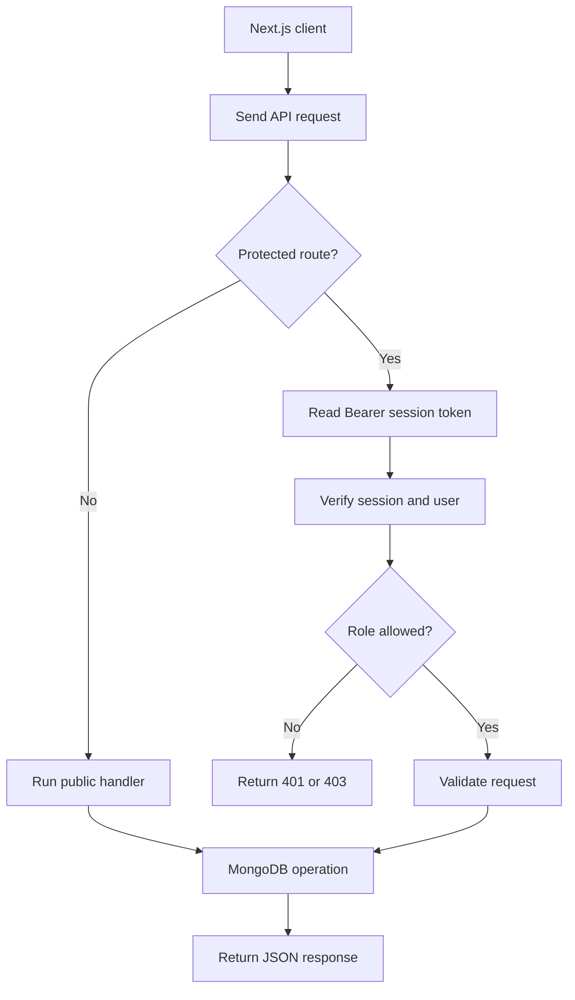

<div align="center">

# JontroLagbe — Server

### REST API for the JontroLagbe equipment rental marketplace

[](https://jontrolagbe-client.vercel.app/)
[](https://github.com/FayroSyrup/JontroLagbe_ServerSide)
[](https://github.com/FayroSyrup/JontroLagbe_ClientSide)

</div>

> **Frontend preview:** The image below is hosted by the client repository. Add the actual homepage screenshot at `docs/images/homepage.png` in the client repository and update the referenced path there when it is ready.

<p align="center">
  
</p>

---

## Overview

This repository contains the **Express.js REST API** for JontroLagbe, a role-based equipment rental marketplace. It provides the data and business-logic layer used by the Next.js client: MongoDB operations, session-token verification, authorization, equipment listings, favorites, bookings, Stripe payment verification, analytics, and scheduled booking maintenance.

The backend is deployed separately from the frontend.

## Live deployments and repositories

| Component | URL |
|---|---|
| **Public website (frontend)** | <https://jontrolagbe.vercel.app/> |
| **Backend API** | <https://jontrolagbe-client.vercel.app/> |
| **Server source code** | <https://github.com/FayroSyrup/JontroLagbe_ServerSide> |
| **Client source code** | <https://github.com/FayroSyrup/JontroLagbe_ClientSide> |

The API root returns `JontroLagbe is running` as a simple deployment health response. It is not the customer-facing website.

## Responsibilities and features

### Authentication and authorization

- Reads Better Auth sessions from the shared MongoDB database.
- Verifies the session token sent by the client as a Bearer token.
- Loads the associated user and checks session expiry and account status.
- Applies role middleware for `customer`, `owner`, and `admin` operations.
- Protects owner and admin resources on the server, not only in the UI.

### User management

- List users for administrators.
- Retrieve and update the current user's profile.
- Promote or change a user's role through an admin-only endpoint.
- Block and unblock users; blocking also removes their active sessions.

### Equipment management

- Create equipment listings as an owner.
- Retrieve an owner's own listings.
- Public search over approved listings.
- Filter by category, rental type, price range, and availability.
- Sort by newest or rental price and return paginated results.
- Retrieve equipment details with visibility checks.
- Update or delete equipment with owner/admin authorization and ownership checks.
- Admin review actions to approve or reject pending listings.

### Favorites

- Add a favorite equipment item.
- List a customer's saved equipment and favorite IDs.
- Remove a favorite.
- Use a unique index to prevent duplicate customer/equipment favorites.

### Bookings and availability

- Create customer bookings with date, quantity, contact, and delivery details.
- Validate date ranges and quantity.
- Calculate rental totals on the server using the listing's price and rental period.
- Check overlapping bookings and temporary unpaid holds before accepting a booking.
- Provide booking history for customers, paid rental lists for owners, and all bookings for administrators.
- Restrict individual booking access to the customer, owner, or administrator associated with it.

### Payments

- Verify completed Stripe Checkout sessions using the Stripe API.
- Confirm that the checkout session belongs to the authenticated customer.
- Persist payment details and update the related booking to paid/confirmed.
- Use a unique session index to make repeated verification requests idempotent.

### Analytics, email, and scheduled maintenance

- Admin analytics for users, equipment, bookings, revenue, monthly payments, and equipment categories.
- Owner analytics for equipment, rentals, completed rentals, and earnings.
- Optional email notifications when rentals are completed (requires mail credentials).
- Booking maintenance completes expired paid rentals and cancels expired unpaid booking holds.
- Uses `node-cron` on a persistent Node.js host and a protected `/cron/update-bookings` endpoint for the Vercel Cron configuration.

## Technology stack

| Area | Technology |
|---|---|
| Runtime | Node.js (ES modules) |
| Framework | Express 5 |
| Database | MongoDB Atlas, native MongoDB Node.js driver |
| Authentication verification | JOSE / Better Auth session and JWT public-key verification |
| Payments | Stripe |
| Scheduled tasks | node-cron and Vercel Cron endpoint |
| Email | Nodemailer |
| Cross-origin requests | CORS |
| Configuration | dotenv |
| Deployment | Vercel |

## API workflow



## Getting started

### Prerequisites

- Node.js 20 or newer.
- npm.
- A MongoDB Atlas cluster and database user with read/write permissions.
- A Stripe account and test-mode secret key for payment testing.
- Gmail app password only if email notifications are needed.
- The companion [JontroLagbe client](https://github.com/FayroSyrup/JontroLagbe_ClientSide).

### 1. Clone the server repository

```bash
git clone https://github.com/FayroSyrup/JontroLagbe_ServerSide.git
cd JontroLagbe_ServerSide
npm install
```

### 2. Configure environment variables

Create a `.env` file in the server project root. Never commit it.

```env
PORT=5000

# MongoDB Atlas credentials
DB_USER=your_database_username
DB_PASSWORD=your_database_password
DB_HOST=your-cluster-host.mongodb.net

# Stripe test-mode secret
STRIPE_SECRET_KEY=sk_test_replace_me

# Exact frontend origin; do not use the backend URL here
CLIENT_URL=http://localhost:3000
BETTER_AUTH_URL=http://localhost:3000

# Optional email notifications
EMAIL_USER=
EMAIL_PASS=

# Secret used to protect the scheduled maintenance endpoint
CRON_SECRET=replace_with_a_long_random_secret
```

Use the same MongoDB cluster, database user, and credentials configured in the client-side Better Auth connection. URL-encode special characters in a password if you place it into a MongoDB URI; the server uses separate `DB_USER`, `DB_PASSWORD`, and `DB_HOST` variables. `CLIENT_URL` and `BETTER_AUTH_URL` must match the frontend's origin.

### 3. Start the API server

```bash
npm run dev
```

The API listens on <http://localhost:5000> by default. Open the root URL to check the health response.

### 4. Seed sample equipment (optional)

```bash
npm run seed
```

The seed script adds the project's sample equipment when the seed data is not already present. Run it only when you intend to populate the connected database; do not expect it to overwrite existing listings or replace their image URLs.

### 5. Run the production command

```bash
npm start
```

Available scripts:

| Command | Purpose |
|---|---|
| `npm run dev` | Run with Node's watch mode for local development. |
| `npm start` | Start the server with Node.js. |
| `npm run seed` | Insert sample equipment when appropriate. |

## Environment variables

| Variable | Required | Description |
|---|---|---|
| `PORT` | No | HTTP port; defaults to `5000`. |
| `DB_USER` | Yes | MongoDB Atlas database username. |
| `DB_PASSWORD` | Yes | MongoDB Atlas database password. |
| `DB_HOST` | Yes | Atlas cluster hostname, without the protocol. |
| `STRIPE_SECRET_KEY` | For payments | Stripe secret key; use `sk_test_...` for testing. |
| `CLIENT_URL` | Yes | Allowed frontend origin for CORS. |
| `BETTER_AUTH_URL` | Yes | Frontend origin hosting the Better Auth JWKS endpoint. |
| `EMAIL_USER` | Optional | Email account used by Nodemailer. |
| `EMAIL_PASS` | Optional | Email app password used by Nodemailer. |
| `CRON_SECRET` | For scheduled endpoint | Long random secret required by `/cron/update-bookings`. |

## Database

The server uses the `jontrolagbedb` database and the following principal collections:

- `user` and `session` — created and maintained by Better Auth on the client side.
- `equipment` — equipment listing records and approval status.
- `bookings` — rental date, quantity, customer, owner, and payment status records.
- `favorites` — customer/equipment favorites.
- `payments` — verified Stripe payment records.

The server creates indexes used to protect payment verification and prevent duplicate favorites.

## Deployment notes

The API is deployed to Vercel at <https://jontrolagbe-client.vercel.app/>. Configure the backend environment variables in the Vercel project settings. In production:

- Set `CLIENT_URL` and `BETTER_AUTH_URL` to `https://jontrolagbe.vercel.app`.
- Set `DB_HOST` to the Atlas cluster hostname and use valid database credentials.
- Set `STRIPE_SECRET_KEY` to the intended Stripe test or live secret.
- Set a strong `CRON_SECRET` matching the scheduled request authorization.
- Configure MongoDB Atlas network access for the deployed runtime using an appropriate secure network strategy.
- Keep all secrets in Vercel environment variables, never in Git.

The client application must have `NEXT_PUBLIC_API_BASE_URL` set to `https://jontrolagbe-client.vercel.app` in production.

## Related repository

The Next.js website, Better Auth configuration, customer/owner/admin dashboards, equipment forms, and client-side API integration are maintained separately:

**[JontroLagbe_ClientSide](https://github.com/FayroSyrup/JontroLagbe_ClientSide)**

## Copyright and usage

Copyright © 2026 **Fayroz Tasnim Rowza**. All rights reserved.

This repository is provided for academic, educational, and portfolio demonstration purposes. No license is granted for commercial reuse, redistribution, or republishing of this project without prior written permission from the copyright holder. Third-party dependencies remain subject to their respective owners' licenses and terms.

---

<div align="center">

**JontroLagbe — API and business logic**

</div>
